<div align="center">

<a href="https://github.com/MEERAN2314"></a>

<a href="https://meeran3.substack.com/"></a>
<a href="https://www.linkedin.com/in/meeran23"></a>
<a href="mailto:meeran231422@gmail.com"></a>






</div>

<details>
<summary>How these cards are built</summary>

<br>

Every card is an animated SVG rendered by one script, `scripts/render_cards.py`, and shown through a plain `` tag. The SVGs use only an inline CSS `<style>` block, SMIL `<animate>` elements and Fira Code subset with `pyftsubset` and embedded as base64 WOFF, so nothing is fetched from outside GitHub. Every animation is switched off under `prefers-reduced-motion`.

| Piece | What it does |
| --- | --- |
| `.github/workflows/cards.yml` | Runs daily: refreshes the data, renders the cards, commits any change |
| `scripts/fetch_contributions.py` | Writes `data/contributions.json`: GitHub's calendar from the GraphQL API, plus your commits on every branch from the REST API |
| `scripts/render_cards.py` | Renders `cards/*.svg`. `STATIC=1` renders the final frame only, for screenshots |
| `cards.config.json` | Name, tagline, colours, links and featured repos |
| `assets/portrait.svg` | Optional vector portrait (`scripts/vectorize_portrait.py`). Set `"portrait"` in the config to show it in the hero |

To preview locally:

```bash
pip install fonttools
python scripts/fetch_contributions.py --sample   # fake data, no token needed
STATIC=1 python scripts/render_cards.py          # final frame
open cards/_preview.html                         # same layout as this page
```

The second graph counts every commit you authored on any branch of your repos, once per commit. GitHub's own graph ignores commits that are not on a default branch. The default workflow token sees public repos only; add a `PROFILE_TOKEN` secret (a personal access token with `repo` and `read:user`) to include private and organisation repos. Settings live under `all_branch` in `cards.config.json`.

Fira Code is licensed under the SIL Open Font License, see `assets/fonts/OFL-LICENSE.txt`.

</details>
